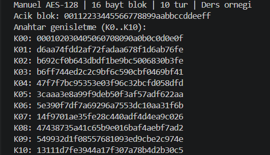
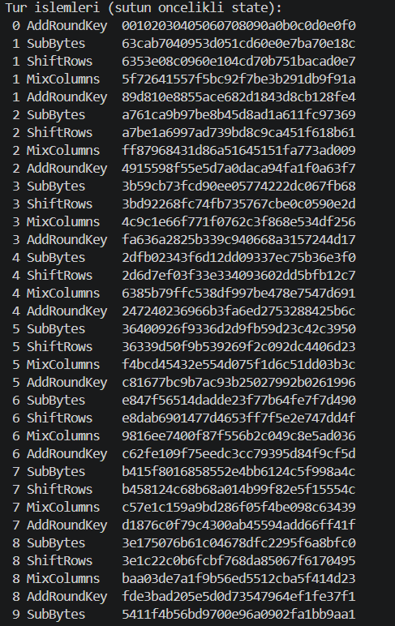
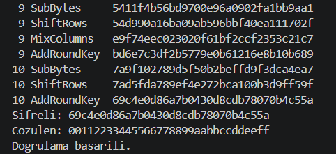
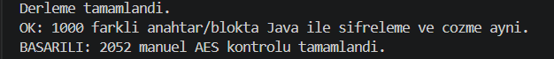

# Ece: manuel AES-128, anahtar genişletme ve turlar

ManualAes128.java kriptografi API'si çağırmadan AES-128 blok şifreleme ve çözme
yapar. Cipher, testte ve demoda bağımsız karşılaştırma için kullanılır. List ve
HexFormat gibi standart Java araçları listeleme ve hex gösterimi içindir.
Şifreleme, anahtar genişletme ve sonlu alan çarpımları elle yazılmıştır.

## Çalıştırma

Proje kökünde:

    .\scripts\manual-aes.ps1

Betik kodu derler; K0–K10 anahtarlarını, 40 ara durumu ve manuel AES ile Java
kütüphanesinin şifreleme/çözme sonuçlarını yan yana gösterir.
PowerShell betiği engellerse:

    powershell -NoProfile -ExecutionPolicy Bypass -File .\scripts\manual-aes.ps1

| Girdi/çıktı | Varsayılan hex değeri |
|---|---|
| Anahtar | 000102030405060708090a0b0c0d0e0f |
| Açık blok | 00112233445566778899aabbccddeeff |
| Beklenen şifreli blok | 69c4e0d86a7b0430d8cdb78070b4c55a |

Kendi ders örneğin için -KeyHex ve -BlockHex seçeneklerine 32'şer hex karakter
ver. 32 hex karakter **16 bayt** eder; 16 harflik bir metinle aynı şey değildir.
Demo anahtarları yazdırdığı için yalnızca örnek anahtarlarla kullanılır.

## 1. State düzeni

Bir AES bloğu 16 bayttır. Dizi konumu **4 × sütun + satır** olarak hesaplanır.
Örnek açık bloğun matrisi:

    00 44 88 cc
    11 55 99 dd
    22 66 aa ee
    33 77 bb ff

Terminalde ara durumlar sütun öncelikli sırayla tek hex satırına çevrilir.
Java byte türü işaretli olduğundan S-box indekslerinde & 0xff kullanılır.

## 2. Anahtar genişletme: expandKey

16 baytlık anahtar dört adet 4 baytlık kelime olarak başlar: w[0]..w[3].
Toplam 44 kelime / 176 bayt üretilir. Her dört kelime bir tur anahtarıdır:
başlangıç anahtarı K0 ve sonraki on turun anahtarları K1–K10.

    temp = w[i-1]
    Eğer i, 4'ün katıysa:
        temp = SubWord(RotWord(temp)) XOR [Rcon, 00, 00, 00]
    w[i] = w[i-4] XOR temp

- RotWord: [a,b,c,d] kelimesini [b,c,d,a] yapar.
- SubWord: dört baytı S-box üzerinden değiştirir.
- Rcon: ilk bayta uygulanır; değerler 01 02 04 08 10 20 40 80 1b 36.
- XOR: dört kelime önceki değerle birleştirir.

Örnekte w[3] = 0c0d0e0f; RotWord sonucu 0d0e0f0c, SubWord sonucu d7ab76fe,
Rcon sonrası d6ab76fe olur. w[0] ile XOR sonucu w[4] = d6aa74fd elde edilir.

    K1 = d6aa74fdd2af72fadaa678f1d6ab76fe

## 3. Şifreleme turları

| Bölüm | İşlem sırası |
|---|---|
| Başlangıç | AddRoundKey(K0) |
| Tur 1–9 | SubBytes → ShiftRows → MixColumns → AddRoundKey(Kr) |
| Tur 10 | SubBytes → ShiftRows → AddRoundKey(K10) |

SubBytes her baytı sabit AES S-box tablosuyla değiştirir.
ShiftRows 0, 1, 2 ve 3. satırı sırasıyla 0, 1, 2 ve 3 konum sola döndürür.
MixColumns her sütunun dört baytını GF(2^8) içinde şu matrisle çarpar:

    02 03 01 01
    01 02 03 01
    01 01 02 03
    03 01 01 02

Toplama XOR'dur; normal tamsayı çarpımı kullanılmaz. multiply metodu kaydırma
ve XOR ile 0x11b indirgeme polinomu altında çarpar.
AddRoundKey state'in her baytını ilgili tur anahtarının baytıyla XOR'lar.
**Son turda MixColumns yoktur.**

| İlk turun adımı | State |
|---|---|
| Başlangıç AddRoundKey | 00102030405060708090a0b0c0d0e0f0 |
| SubBytes | 63cab7040953d051cd60e0e7ba70e18c |
| ShiftRows | 6353e08c0960e104cd70b751bacad0e7 |
| MixColumns | 5f72641557f5bc92f7be3b291db9f91a |
| AddRoundKey(K1) | 89d810e8855ace682d1843d8cb128fe4 |

## 4. Çözme ve API

decryptBlock önce K10'u ekler. Tur 9'dan 1'e InvShiftRows → InvSubBytes →
AddRoundKey → InvMixColumns uygular. Son bölüm InvShiftRows → InvSubBytes →
AddRoundKey(K0) şeklindedir. Ters MixColumns'un ilk satırı 0e 0b 0d 09 olur.

    ManualAes128 aes = new ManualAes128(key);
    byte[] encrypted = aes.encryptBlock(block);
    byte[] original = aes.decryptBlock(encrypted);

Anahtar ve blok tam 16 bayt olmalıdır; null veya başka uzunluklar reddedilir.
Girdiler değiştirilmez. roundKeys() iç anahtarların kopyasını verir;
traceEncryption(block) şifrelemenin her adımını değişmez hex kayıtlarıyla sunar.

## 5. Doğrulama ve sınırlar

### Terminalde kütüphane çıktısıyla karşılaştırma

`scripts/manual-aes.ps1` çalıştırıldığında demo, aynı 16 bayt anahtar ve açık
bloğu hem manuel AES'e hem Java `Cipher` (`AES/ECB/NoPadding`) uygulamasına
verir. Çözme karşılaştırmasında ikisine de manuel şifrelemenin ürettiği aynı
şifreli blok verilir. Sonuçlar bayt bayt karşılaştırılır; çözülen blokların
başlangıç girdisine eşit olduğu ayrıca kontrol edilir. Uyuşmazlıkta program
hata koduyla sonlanır.

Varsayılan örnekte karşılaştırma bölümü:

```text
Islem        Manuel AES                       | Java kutuphanesi
Sifreleme    69c4e0d86a7b0430d8cdb78070b4c55a | 69c4e0d86a7b0430d8cdb78070b4c55a
Cozme        00112233445566778899aabbccddeeff | 00112233445566778899aabbccddeeff
Sifreleme sonuclari: ESLESTI
Cozme sonuclari: ESLESTI
Orijinal blok geri elde edildi: EVET
Dogrulama basarili.
```

Farklı bir anahtar/blokla karşılaştırmak için:

```powershell
.\scripts\manual-aes.ps1 -KeyHex '2b7e151628aed2a6abf7158809cf4f3c' -BlockHex '6bc1bee22e409f96e93d7e117393172a'
```

Bu örnekte her iki şifreleme çıktısı `3ad77bb40d7a3660a89ecaf32466ef97` olmalıdır.
Ekran görüntüsü için anahtar ve açık blok ile sondaki karşılaştırma tablosunu kaydedin.

### Otomatik kontroller ve kapsam

scripts/test.ps1 şu kontrolleri de çalıştırır:

- FIPS örneğinin sonucu, 11 tur anahtarı ve ilk turun ara değerleri.
- NIST SP 800-38A'daki dört blok için şifreleme ve çözme.
- 1.000 farklı anahtar/blokta Java AES/ECB/NoPadding ile bağımsız şifreleme
  ve çözme karşılaştırması. Sabit rastgele tohum yalnızca test tekrarlanabilirliği içindir.
- Geçersiz girdiler, girdi dizilerinin korunması ve anahtar kopyalarının bağımsızlığı.

Bu **blok çekirdeği doğruluk karşılaştırmasıdır**; performans ölçümü değildir.
ECB burada tek bloğu Java AES çekirdeğiyle doğrudan karşılaştırır.
Manuel sınıf padding, GCM, nonce veya doğrulama etiketi sağlamaz.
Ağdaki mesaj ve PDF aktarımı mevcut Java AES-GCM kanalını kullanır.
Tablo erişimleri sabit zamanda çalışacak şekilde tasarlanmamıştır; bu sınıf
ders ve inceleme amaçlıdır.

## Çalıştırma ekran görüntüleri

Ece'nin demo çalıştırması ve otomatik test sonucundan alınan görüntüler aşağıdadır.

**Anahtar genişletme: K0–K10**



**Tur işlemleri: başlangıç ve ara adımlar**



**Son tur, şifreli blok ve çözme sonucu**



**Otomatik test sonucu**



Test görüntüsü, 1.000 farklı anahtar/blokta Java ile şifreleme ve çözme
sonuçlarının aynı olduğunu ve 2.052 manuel AES kontrolünün başarıyla
tamamlandığını gösterir. Diğer üç görüntü, kütüphane karşılaştırma tablosu
eklenmeden önceki demo çıktısıdır.

## Sunumda kısa anlatım

“128 bit anahtardan 11 tur anahtarı ürettim. Önce başlangıç anahtarını bloğa
XOR'ladım. İlk dokuz turda bayt değiştirme, satır kaydırma, sütun karıştırma ve
tur anahtarı ekleme yaptım. Onuncu turda sütun karıştırmayı atladım. Sonucu
bilinen vektörler ve Java AES ile karşılaştırdım.”

## Kaynaklar

- [NIST FIPS 197](https://csrc.nist.gov/pubs/fips/197/final): AES ve anahtar genişletme.
- [FIPS 197 (2001), Ek C.1](https://csrc.nist.gov/files/pubs/fips/197/final/docs/fips-197.pdf):
  örneğin tur anahtarları ve ara durumları.
- [NIST SP 800-38A, F.1.1–F.1.2](https://nvlpubs.nist.gov/nistpubs/Legacy/SP/nistspecialpublication800-38a.pdf):
  dört blokluk test vektörleri.
