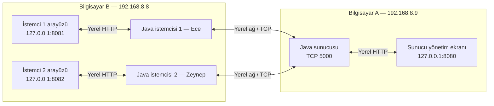
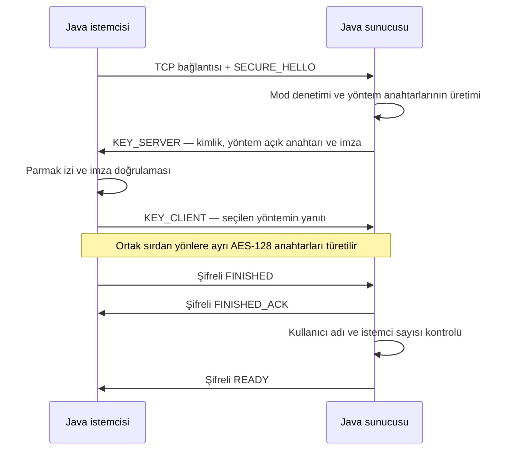
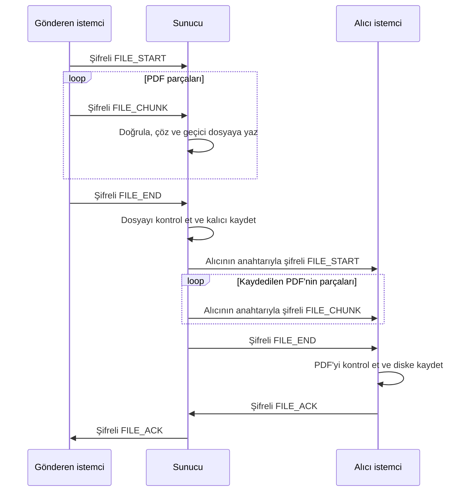

# Rapor taslağı — Sistem mimarisi ve sunucunun çalışma akışı

**Bölüm sorumlusu:** Sudenur Erdoğan  
**Hazırlama tarihi:** 9 Kasım 2026  
**İncelenen kod sürümü:** `e163a8d`

> Hazırlık notu — Bu dosyadaki 2 ve 3 numaralı bölümler teknik rapora aktarılmak üzere hazırlanmıştır. Ağ adresleri, repoda belgelenen 16 Ekim 2026 tarihli güvensiz mod deneyine aittir; güvenli mod deneyinin güncel IP adresleri veya sonuçları olarak sunulmamalıdır. Son bölümdeki teslim kontrolü ve bu hazırlık notu nihai rapor metnine dahil edilmez. Metin, mevcut uygulamanın tasarımını açıklar; yeni bir deney yapıldığı anlamına gelmez.

## 2. Sistem Mimarisi

### 2.1. Genel yapı ve bileşenler

Bu projede, bir sunucu ve iki istemciden oluşan merkezi bir haberleşme sistemi geliştirilmiştir. İstemciler arasında doğrudan bağlantı kurulmaz. Bir istemcinin gönderdiği metin veya PDF önce sunucuya ulaşır; sunucu veriyi işleyerek diğer istemciye iletir. Böylece mesajların yönlendirilmesi, bağlantıların yönetilmesi ve çalışma modunun denetlenmesi tek bir merkezde gerçekleştirilir. İki istemci aynı anda veri gönderebilir.

Uygulamanın haberleşme ve kriptografi işlemleri Java ile gerçekleştirilmiştir. Kullanıcı arayüzleri HTML, CSS ve JavaScript kullanılarak hazırlanmıştır. Her Java uygulaması kendi bilgisayarında bir yerel HTTP arayüzü sunar. Kullanıcı tarayıcıdan bu arayüze erişir; diğer bilgisayarla TCP bağlantısını kuran ve şifrelemeyi gerçekleştiren bileşen Java istemcisidir. Sunucu yönetim ekranı da sunucu bilgisayarının tarayıcısında açılır.

| Bileşen | Görevi |
|---|---|
| Java sunucusu (`RelayServer`) | En fazla iki sohbet istemcisini yönetir; metinleri yönlendirir, PDF'leri kaydeder ve alıcıya iletir. |
| Java istemcisi (`ChatClient`) | Sunucuya bağlanır; metin ve PDF gönderir, gelen içeriği alır ve dosya teslimini onaylar. |
| Yerel web arayüzü (`WebUi`) | Bağlantı ayarlarını, mesaj geçmişini, PDF işlemlerini ve sunucu yönetimini kullanıcıya sunar. |
| Haberleşme katmanı (`Protocol`, `SecureChannel`) | Mesajları çerçevelere ayırır; güvenli modda şifreleme, bütünlük ve sıra denetimini uygular. |
| Anahtar paylaşımı (`KeyExchange`, `Crypto`) | Seçilen yöntemle ortak sır oluşturur, sunucu kimliğini doğrular ve trafik anahtarlarını türetir. |
| Dosya yönetimi (`FileStore`) | PDF parçalarını birleştirir, tamamlanan dosyaları kaydeder ve indirmeye sunar. |

Güncel uygulama JDK 25 veya üzerini gerektirir. Ağ erişiminde Java soketleri, yerel arayüzde JDK HTTP sunucusu, kriptografide Java'nın JCA/JCE API'leri kullanılır. Manuel AES sınıfı, algoritmanın adımlarını incelemek ve kütüphane çıktısıyla karşılaştırmak için ayrı tutulmuştur; gerçek haberleşme Java AES-GCM kanalı üzerinden yürütülür.

### 2.2. Ağ topolojisi

Sistem aynı yerel ağa bağlı en az iki fiziksel bilgisayarda çalışacak şekilde düzenlenmiştir. İki bilgisayarlı yerleşimde sunucu Bilgisayar A'da, iki ayrı Java istemcisi ise Bilgisayar B'de çalışır. İstemcilerin ayrı süreçler olması, aynı bilgisayarda farklı kullanıcılarla bağımsız bağlantılar kurulmasını sağlar. İstenirse istemcilerden biri üçüncü bir bilgisayarda da çalıştırılabilir.

16 Ekim 2026 tarihli güvensiz mod kayıtlarının inceleme notlarında sunucu adresi `192.168.8.9`, istemci bilgisayarının adresi `192.168.8.8` olarak belgelenmiştir. Aşağıdaki şekil bu adresleri ve uygulamanın belgelenmiş web portlarıyla kurulan yerleşimini göstermektedir. Web portları ağ kaydından doğrulanmış deney verisi değildir; yerel arayüz için kullanılan çalıştırma ayarlarıdır.

*Şekil 1. İki fiziksel bilgisayar üzerinde sunucu ve iki istemcinin yerleşimi. İstemciler arasındaki haberleşme sunucu üzerinden gerçekleştirilir.*

| Adres / port | Kullanım |
|---|---|
| `192.168.8.9:5000` | Belgelenen deneyde istemcilerin bağlandığı sunucu TCP uç noktası |
| `127.0.0.1:8080` | Sunucu bilgisayarındaki yönetim ekranı için kullanılan yerel adres |
| `127.0.0.1:8081` | İstemci bilgisayarındaki birinci web arayüzü için kullanılan yerel adres |
| `127.0.0.1:8082` | İstemci bilgisayarındaki ikinci web arayüzü için kullanılan yerel adres |

`127.0.0.1` her bilgisayarın kendisini ifade eder. Bu nedenle istemcinin tarayıcısı yerel web adresini açarken, bağlantı formuna uzak sunucunun yerel ağ IP adresi yazılır. Bilgisayarlar arasındaki proje trafiği TCP 5000 üzerinden taşınır. İstemcilerin kaynak TCP portları işletim sistemi tarafından atanır; web arayüzlerinin 8081 ve 8082 portları bu kaynak portları değildir.

### 2.3. Veri taşıma ve güvenlik sınırı

Metinler ve dosya parçaları TCP üzerinde uygulamaya ait çerçevelerle taşınır. Her çerçevenin başında yük uzunluğu bulunur; ardından mesaj türü, gönderen/aktarım kimliği, metin ve varsa ikili veri alanı gelir. Böylece tek bir uygulama mesajı farklı TCP paketlerine bölünse de alıcı mesajı doğru sınırlar içinde okuyabilir. Dosya aktarımında en fazla 10 MiB PDF kabul edilir ve veri 32 KiB büyüklüğüne kadar parçalara ayrılır.

Güvensiz modda bu içerik şifrelenmeden iletilir. Güvenli modda ise uygulama çerçevesi AES-128-GCM ile korunarak `SECURE` türündeki dış çerçevede taşınır. Her istemci–sunucu bağlantısının anahtarları ayrı oluşturulur; ayrıca gönderme ve alma yönleri için farklı trafik anahtarları türetilir. İstemci 1'den gelen içerik sunucuda çözülür ve İstemci 2'ye ait gönderim anahtarıyla yeniden şifrelenir.

Sunucu bu tasarımda güvenilen bir bileşendir ve iletilen içeriği okuyabilir. Koruma, Java istemcileri ile Java sunucusu arasındaki ağ aktarımını kapsar. Sunucunun ve alıcının diske kaydettiği PDF'ler okunabilir durumdadır. Mesaj geçmişi bellekte tutulur; uygulama yeniden başlatıldığında geçmiş sıfırlanır.

## 3. Güvenli Mod Akışı

### 3.1. Sunucunun başlatılması ve bağlantı kurulması

Sunucu başlatıldığında TCP dinleme soketi, yerel yönetim arayüzü ve sunucu kimliği hazırlanır. Her başlangıçta Ed25519 kimlik anahtar çifti üretilir; açık anahtarın SHA-256 parmak izi yönetim ekranında gösterilir. Sunucu başlangıçta güvensiz moddadır. Yönetim ekranından güvenli moda geçildiğinde açık bağlantılar kapatılır ve istemcilerin aynı modu seçerek yeniden bağlanması gerekir.

Güvenli bağlantı kurulurken istemci kullanıcı adını, anahtar paylaşım yöntemini ve rastgele başlangıç değerini gönderir. Sunucu mod uyumunu denetler ve seçilen yöntem için anahtar paylaşımını başlatır. İstemci, sunucuyu çalıştıran kişiden aldığı parmak izini kullanarak sunucu kimliğini; sunucunun imzasıyla da anahtar paylaşım yanıtını doğrular. RSA-2048, DH-2048, ECDH P-256 veya ML-KEM-768 yöntemiyle elde edilen ortak sırdan HKDF-SHA256 aracılığıyla yönlere özgü AES-128 anahtarları türetilir.

İstemci şifreli `FINISHED`, sunucu ise şifreli `FINISHED_ACK` mesajını göndererek anahtarların kullanılabildiğini ve el sıkışma özetinin eşleştiğini doğrular. Sunucu kullanıcı adının benzersizliğini ve iki sohbet istemcisi sınırını kontrol eder. Uygun bağlantıya `READY` gönderilir ve istemci aktif bağlantılar arasına eklenir. Geçersiz mod, kimlik veya anahtar doğrulaması durumunda bağlantı kabul edilmez.

*Şekil 2. Normal sohbet bağlantısında güvenli oturumun kurulması. İkinci istemci için de bağımsız bir anahtar paylaşımı gerçekleştirilir.*

### 3.2. Metnin sunucu üzerinden yönlendirilmesi

Gönderen istemci, kullanıcının metnini kendi bağlantısının AES-GCM gönderim anahtarıyla şifreler. Sunucu gelen çerçevenin sırasını ve doğrulama etiketini denetleyerek içeriği çözer. Gönderenin adı, mesajda belirtilen değere güvenilerek değil, sunucunun bağlantı kaydından alınır.

Sunucu diğer istemcinin bağlı olduğunu ve çalışma modlarının uyumlu olduğunu kontrol eder. Metni alıcı bağlantısına ait anahtarla yeniden şifreleyerek gönderir, ardından sunucu ekranında görüntülenecek geçmiş kaydını oluşturur. Gönderene `SENT` mesajı iletilir. Bu mesaj, sunucunun alıcı soketine yazabildiğini belirtir; alıcı kullanıcının metni okuduğu anlamına gelmez. Alıcı bağlı değilse hata bildirilir.

### 3.3. PDF'nin sunucuda kaydedilmesi ve teslim onayı

PDF aktarımı `FILE_START`, bir veya daha fazla `FILE_CHUNK` ve `FILE_END` mesajıyla gerçekleştirilir. Güvenli modda dosya bilgileri, parçalar ve teslim onayları AES-GCM kanalından geçer. Sunucu çözülen parçaları geçici `.part` dosyasına yazar. Aktarım sonunda boyut ve PDF başlığı kontrolleri yapılarak dosya `runtime/server/` altında benzersiz bir kimlikle kaydedilir. Sunucu dosyanın tamamını aldıktan sonra alıcıya iletmeye başlar.

*Şekil 3. Sunucunun PDF'yi kaydettikten sonra yeniden şifreleyerek yönlendirmesi ve alıcı kayıt onayının gönderene iletilmesi.*

Alıcı dosyayı başarıyla kaydettiğinde `FILE_ACK` gönderir. Sunucu, onayın beklenen alıcı ve aktarım kimliğine ait olduğunu denetleyerek gönderene iletir. Böylece göndericide “Alıcıya teslim edildi” bilgisi gösterilir. Bu onay Java istemcisinin dosyayı kaydettiğini ifade eder; kullanıcının tarayıcıdan İndir düğmesine basmış olması gerekmez. Süre aşımı veya alıcı bağlantısının kesilmesi durumunda aktarım hatası bildirilir. Normal bağlantı kapanışında tamamlanmamış geçici dosya temizlenir.

Sunucu, bağlantıları ayrı iş parçacıklarıyla işler. Güvenli/güvensiz mod değiştirildiğinde eski oturumlar kapatılır; bu nedenle devam eden aktarım sırasında mod değiştirilmesi aktarımı keser. Yeni bağlantılar seçilen moda göre yeniden kurulur.

---

## Teslim öncesi kontrol — rapora dahil edilmeyecek

- [ ] Güvenli mod deneyindeki gerçek IP adreslerini ve uygulamaların hangi bilgisayarlarda çalıştığını doğrula. Değişmişse Şekil 1 ve adres tablosunu güncelle; güvensiz deneyin tarihini koru.
- [ ] Her deney bilgisayarının gerçek JDK, işletim sistemi ve Wireshark sürümünü raporun deney ortamı bölümüne ekle. JDK 25+ proje gereksinimidir; deneydeki kesin sürüm ayrıca kaydedilmelidir.
- [ ] Mermaid çizimlerini rapora okunabilir şekiller olarak aktar. Şekil numaralarını nihai raporun sırasına göre düzenle.
- [ ] Sistem mimarisi ve güvenli mod akışı bölümlerinin, toplam 6–10 sayfalık raporda yaklaşık 2–3 sayfalık yer kaplamasını hedefle; gerekirse sınıf tablosunu kısalt.
- [ ] Anahtar yöntemlerinin ayrıntılarını 4. bölümde, manuel AES karşılaştırmasını 5. bölümde, gerçek paket ve ölçüm kanıtlarını ilgili deney bölümlerinde sun. Bu taslağa yapılmamış deney sonucu ekleme.
- [ ] Son kod değişikliklerinden sonra mod davranışını, dosya sınırını ve onay akışını yeniden kontrol et.

## Taslağın dayanakları — rapora dahil edilmeyecek

- [Proje yönergesi](../Kriptoloji_Grup_Projesi_2026_2027.pdf): Bölüm 2, 3 ve rapor şablonu.
- [Güvensiz deneyin belgelenmiş topolojisi](../captures/insecure/README.md): IP adresleri ve iki istemcinin bağlantıları.
- [Kurulum ve bileşenler](../README.md): Program yerleşimi ve web portları.
- [Güvenli mod açıklaması](SECURE_MODE.md): Seçilen parametreler ve deney sınırları.
- [Sunucu](../src/main/java/tr/edu/crypto/RelayServer.java): Bağlantı, yönlendirme, mod ve teslim onayı yönetimi.
- [Yerel web arayüzü](../src/main/java/tr/edu/crypto/WebUi.java): Loopback HTTP erişimi.
- [Anahtar paylaşımı](../src/main/java/tr/edu/crypto/KeyExchange.java) ve [güvenli kanal](../src/main/java/tr/edu/crypto/SecureChannel.java): El sıkışma, anahtar türetme ve AES-GCM.
- [Dosya yönetimi](../src/main/java/tr/edu/crypto/FileStore.java) ve [istemci](../src/main/java/tr/edu/crypto/ChatClient.java): Parçalı aktarım, kayıt ve onay.
